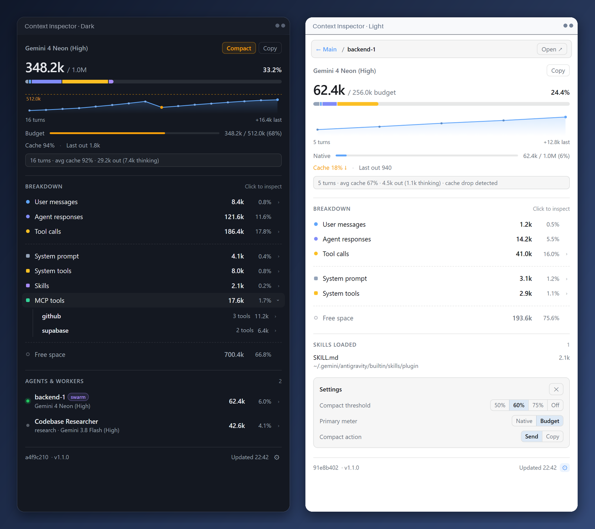
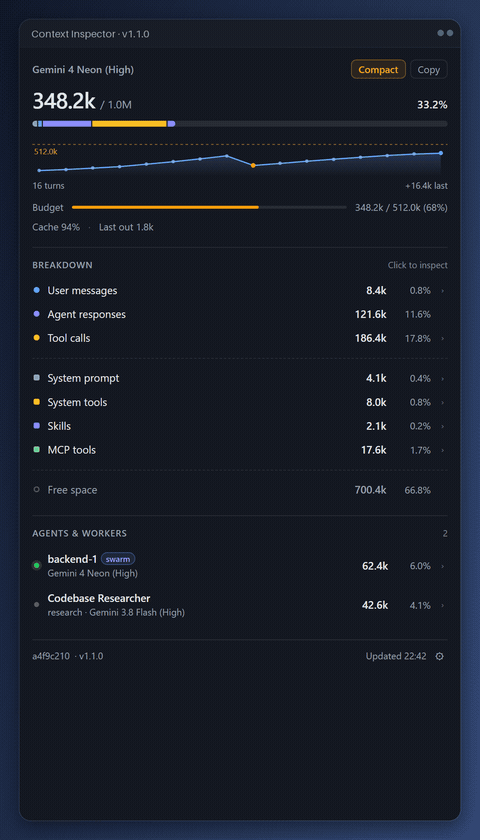

<p align="center">
  
</p>

<h1 align="center">Antigravity Context Inspector</h1>

<p align="center">
  A minimalist, live <strong>Context Window &amp; Subagent Inspector</strong> side panel for the <strong>Antigravity 2.0</strong> desktop app.
</p>

<p align="center">
  <a href="https://github.com/sametozbalkan/antigravity-context-inspector/actions/workflows/ci.yml">
    
  </a>
  <a href="LICENSE">
    
  </a>
  
  
</p>

<p align="center">
  
</p>

<details align="center">
  <summary><strong>Watch interactive walkthrough (Sparkline · MCP Servers · Settings · Swarm)</strong></summary>
  <br />
  
</details>

---

## Highlights

- **Exact token accounting — not character guesses.** Reads the actual `ContextWindowMetadata` breakdown and prompt payload stored in `~/.gemini/antigravity/conversations/<id>.db` (read-only), paired with live model limits from Antigravity’s model catalog. Zero extra LLM tokens consumed.
- **Turn-by-turn growth sparkline.** Crisp 44px SVG sparkline right below the context bar shows token growth across turns with per-turn markers, compaction drops, labeled budget thresholds, and effortless full-card hover telemetry.
- **Native window &amp; request trim budget.** Shows both the model’s native context capacity (e.g. `1M`) and Antigravity’s per-request compaction/trim budget (e.g. `512k`, `256k`, or `128k`) — switchable as the primary meter via `⚙` Settings.
- **Prompt cache drop alert &amp; session summary.** Flags unexpected prompt cache drops (`Cache 18% ↓`) in amber when caching was previously active, and expands a 1-line session summary (`turns · avg cache · total out · thinking`) on click.
- **Minimalist single-page overview with MCP server breakdown &amp; inline peek.** Click any category to rank items by token cost, drill into **MCP servers** (`github`, `supabase`, …) before inspecting individual tool schemas, and peek or copy exact payloads sent to the model.
- **Subagent &amp; Swarm Worker monitoring.** Automatically detects both `invoke_subagent` subagents and **Swarm workers** (`members.json`), displaying live status, token usage, and full `← Main` / `Open ↗` drill-down.
- **Configurable `/compact` control &amp; persisted `⚙` settings.** Configure compact threshold (`50%`, `60%`, `75%`, `Off`), primary meter (`Native` / `Budget`), and compact action (`Send /compact` with two-step confirmation or 1-click `Copy only`) — persisted outside iframe storage in `settings.json`.
- **Native Dark &amp; Light mode.** Syncs automatically with Antigravity’s live theme variables via the sidecar preload bridge.
- **Zero external dependencies.** Uses only Python 3 standard library and Antigravity’s bundled Node.js runtime — no `npm install`, no `pip install`, no build step.

---

## Requirements

- **Antigravity 2.0 Desktop**
- **Python 3** available on your `PATH` (`python`, `py`, or `python3`)

---

## Installation

### Option 1 — One-line installer (recommended)

**Windows (PowerShell):**
```powershell
irm https://raw.githubusercontent.com/sametozbalkan/antigravity-context-inspector/main/scripts/install.ps1 | iex
```

**macOS / Linux:**
```bash
curl -fsSL https://raw.githubusercontent.com/sametozbalkan/antigravity-context-inspector/main/scripts/install.sh | bash
```

### Option 2 — `git clone`

**Windows (PowerShell):**
```powershell
git clone https://github.com/sametozbalkan/antigravity-context-inspector.git "$HOME\.gemini\config\plugins\context-inspector"
```

**macOS / Linux:**
```bash
git clone https://github.com/sametozbalkan/antigravity-context-inspector.git ~/.gemini/config/plugins/context-inspector
```

### Enable the side panel

1. Open **Antigravity → Customizations → Installed** and make sure **Context Inspector** is enabled (restart Antigravity if it does not appear immediately).
2. Open any conversation and select **Context Inspector** from the right-hand side panel **`+`** menu.

---

## Updating

Context Inspector supports three ways to stay up to date:

1. **In-panel update notification:** The sidecar checks GitHub Releases quietly in the background (cached every 12 hours). When a newer version is published, a subtle `vX.Y.Z available` pill appears in the footer:
   - If installed via `git`, click **Update now** to run `git pull --ff-only` explicitly, then toggle the plugin off and on in Customizations.
   - You can also copy the update command or open the GitHub Release notes without modifying files automatically.
2. **Manual `git pull`:**
   ```bash
   git -C ~/.gemini/config/plugins/context-inspector pull --ff-only
   ```
3. **Re-run the one-line installer:** Running `install.ps1` / `install.sh` again updates an existing installation in place.

---

## Native Context vs. Request Budget

Models like Gemini expose a **1M-token native context window**, while Antigravity applies a smaller per-request **trim / compaction budget** (for example `512k`, `256k`, or `128k` depending on the model) to keep latency low and prevent long-turn context degradation.

- The large top bar shows usage against the model’s **native window**.
- The **Budget** row shows usage against Antigravity’s **active trim threshold** — the point where older history starts getting compacted or trimmed.
- The **Compact** button appears when usage reaches **60%** of the active budget (or 60% of the native window when no separate budget applies).

---

## Architecture

```text
antigravity-context-inspector/
├── plugin.json                        # Antigravity plugin manifest
├── assets/logo.svg                    # Plugin icon
├── scripts/
│   ├── install.ps1                    # Windows PowerShell installer/updater
│   └── install.sh                     # macOS / Linux installer/updater
├── sidecars/inspector/
│   ├── sidecar.json                   # Registers AUX_PANE side panel
│   ├── package.json
│   ├── main.mjs                       # Sidecar HTTP server, mtime-cached static assets, model catalog, LRU cache, update check
│   ├── inspector.py                   # CLI entrypoint & snapshot assembler
│   ├── lib/
│   │   ├── protobuf.py                # Minimal wire decoder (stdlib only)
│   │   ├── accounting.py              # Token breakdown, checkpoints, file detection
│   │   ├── subagents.py               # Subagent & Swarm worker discovery and stats
│   │   └── content.py                 # System sections, tool schemas, active messages
│   └── public/
│       ├── index.html                 # HTML shell (loads classic /app.js)
│       ├── styles.css                 # Theme-aware minimalist CSS
│       ├── app.js                     # Panel state, API polling, delegated click handling
│       └── js/
│           ├── utils.js               # Formatting, escaping, clipboard & path helpers
│           ├── sparkline.js           # Turn-by-turn SVG sparkline & hover telemetry
│           └── views.js               # Pure HTML template renderers
└── tests/
    └── test_inspector.py              # End-to-end synthetic SQLite tests (unittest)
```

### How it works

1. The panel receives the active conversation ID and workspace URIs from Antigravity’s `/preload.js` bridge and polls `/api/report` every 3 seconds while visible.
2. `main.mjs` fingerprints the conversation’s `.db` and `-wal` files (plus any discovered subagent databases) and only invokes `inspector.py --json` when something actually changed.
3. All database connections open strictly read-only (`?mode=ro`). Full item payloads are served instantly from the backend’s in-memory LRU cache via `/api/item` when you click to inspect a row.

---

## CLI Usage & Testing

The Python parser also works standalone from the command line:

```bash
# Latest Antigravity Desktop conversation
python sidecars/inspector/inspector.py

# Specific conversation ID as structured JSON
python sidecars/inspector/inspector.py --conversation-id <uuid> --json

# Arbitrary SQLite conversation database
python sidecars/inspector/inspector.py --db /path/to/<uuid>.db
```

Run the zero-dependency test suite:

```bash
python -m unittest discover -s tests -v
```

---

## License

[MIT](LICENSE) © 2026 [Samet Ozbalkan](https://github.com/sametozbalkan)
